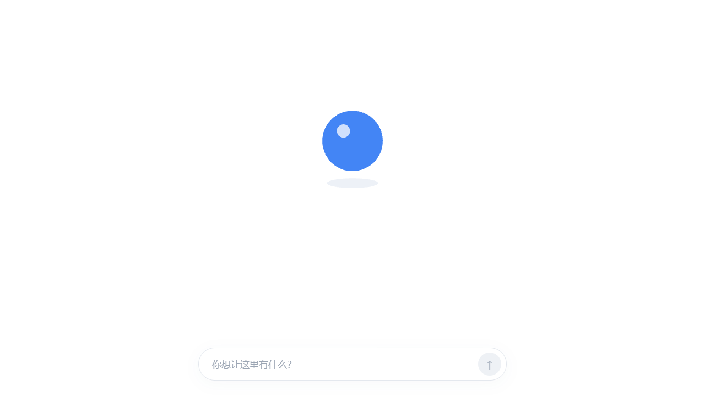

# 首个可运行版本验收记录

日期：2026-11-17（Asia/Shanghai）。产品范围为确定性「有一个球」样例，不包含真实模型。

已验证应用源码提交：`e5300f4`。后续仅更新本验收文档与截图时，以此提交的运行行为为基线。

## 本地实测

Windows 11，Node.js 24.11.1，npm 11.6.2。使用根目录命令，未配置模型凭证。

| 检查 | 结果 |
| --- | --- |
| `npm run check` | TypeScript 检查与 26 项协议、沙箱、API/持久化测试通过 |
| `npm run build` | Vite 前端、Worker/WASM 和 Node 服务端生产构建通过 |
| `npm start` | 单进程在 3000 提供页面、API 和 WASM，实际样例链路通过 |
| `npm run dev` | 5173 同址代理 API；可见浏览器输入中文、Enter 不提交、点击发送出现球 |
| `npm run test:e2e` | 12/12，通过 Chrome、Edge、Pixel 7 尺寸/触摸模拟三组测试 |

生产端到端测试中的观测值（自动化墙钟，含浏览器操作与断言开销；不是模型性能承诺）：

| 环境 | 浏览器版本 | 本地反馈 | 首次可辨认变化 |
| --- | --- | ---: | ---: |
| Windows Chrome | 157.0.8103.51 | 54 ms | 374 ms |
| Windows Edge | 157.0.4341.60 | 52 ms | 870 ms |
| 手机尺寸模拟 | Chrome 157.0.8103.51 | 51 ms | 861 ms |

三组样例包 SHA-256 一致：`b81e4ebfccf6669bc707feb88f4048ebed2e07aa9ec7bcfd24f2c8fcfc977571`。

## 已通过的行为

- 在同一个 canvas 上显示由候选脚本实际产生的圆、反光和影子；只有服务端提交成功后才显示。
- 输入原文（含首尾空格）、生成请求/原始响应、协议、代码、文件哈希、试跑回执和世界状态可逐轮核对。
- 停止生产服务进程后重新启动，使用全新浏览器上下文打开原世界 URL；版本 ID、完整状态、绘图操作和包哈希保持一致，没有新增轮次或尝试。
- 网络重发、提交响应丢失、提交回执丢失、并发重复回执不会产生重复版本。
- 同一世界的连续提交排队，新尝试使用最近已提交基线；过期尝试和失效基线不能提交。
- 不支持的输入保留原文，失败重试创建新尝试；最近成功的球不消失。
- 无限循环、64MiB 分配、网络/DOM/Node API 访问、外部导入、输出超限、非法状态/绘图与哈希不符均被拒绝。
- SSE 根据持久化序号补取；重启中断的候选保留产物并标记失败，可以重试。
- 中文组合输入事件期间不会提交；Enter 不直接发送整句。

## 远端和实机

应用源码提交 `e5300f4` 的 [GitHub Actions 检查](https://github.com/nkvic520/and-there-was/actions/runs/44048333006) 全部通过：Windows 与 Ubuntu 均完成干净 `npm ci`、26 项核心测试、生产构建和 4 项 Chromium 端到端测试；容器完成镜像构建、独立持久卷启动、隔离试跑、提交、重启及快照/运行包恢复。

容器验收版本 ID：`c37109c4-fc18-4163-b6e9-7e0871169205`；包哈希与本地三组测试一致。当前电脑没有 Docker，以上容器结果来自实际 GitHub Linux runner，而非本机推测。

Android 已连接 REDMI Turbo 4，Android 16，Edge 149.0.4022.80，并验证 ADB 反向端口映射已建立。但自动审批拒绝了通过 ADB 启动浏览器、读取调试接口并截图的命令（返回 `blocked by policy`），因此转为用户操作手机。用户随后确认看到球的是电脑/Codex 内置浏览器，**Android 实机的软键盘、候选确认、触摸发送和恢复均仍为待验收**。Chrome 未安装，不宣称 Android Chrome 已通过。

系统级 Windows 中文输入法候选操作、离线听写及实际 Codespaces 会话尚未完成实测。应用不录音，不能验证输入法是否在设备上离线识别。

## 复现方法

1. `npm ci`，运行 `npm run build` 和 `npm start`，打开 `http://127.0.0.1:3000/`。
2. 记录页面自动生成的 `/w/<世界ID>` 地址；输入「有一个球」并点击发送。
3. 打开 `/inspect/<世界ID>`，核对原文、协议、源码、试跑记录和状态。
4. 停止服务，再使用相同 `DATA_DIR` 运行 `npm start`。在新的浏览器会话打开第 2 步地址，核对球和版本；不要打开首页创建新世界。
5. 执行 `npm run check`、`npm run test:e2e` 自动复现失败、重复请求和恢复测试。
6. 有 Docker 时运行 `npm run test:container`，使用独立临时持久卷验证镜像启动、提交和重启恢复。也可 `docker compose up --build -d` 后 `docker compose restart`，保留 `world-data` 卷。

Android 实机可在已授权 ADB 连接后执行 `adb -s <设备序列号> reverse tcp:3000 tcp:3000`，再在手机浏览器打开同一个 localhost 地址。验收后可用 `adb -s <设备序列号> reverse --remove tcp:3000` 移除映射。
